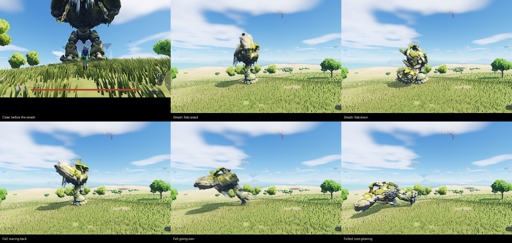

# Colossi

Herod, a 30 m stone golem, roams the open land, after *Shadow of the Colossus*'s Argus and Valus. Its tuning is `COLOSSUS` in `src/lib/constants.ts`.

## Playing

- **Where:** one may roam in each 600 m cell (90 % of them), in every biome: anywhere dry and not too steep, mountains, desert, jungle and tundra included (on average one every 0.64 km). Up to three at once. It comes into being within 800 m of a player and is the same colossus at the same spot on every visit to a seed. Slain, it never comes back.
- **Senses:** it notices you within 150 m (its name comes up) and walks after you, turning as it goes, until you are in reach before it. It walks at 1.35 m/s and turns at about 10°/s: you can outrun it and get behind it. It gives up beyond 260 m.
- **Attacks** (each lands as a shockwave you can jump over at its edge; a dodge lets any of them pass; no shield stops them). Wind-ups are short and every move eases in and out:
  - **Smash:** you before it, in reach: both fists raised high over its head, then brought down before it. Close: 3 hearts and you are flung; the shockwave: 1¼ hearts.
  - **Stomp:** only when you stand within 7 m of one of its feet. That foot comes up over you and down. 2½ hearts, ¾ on the shockwave.
  - **Fall:** you before it, further off: it rears back, arms up, then throws its whole body down forward. Under it: 4 hearts. It then lies **felled** for 6 s, its core glowing, and pushes itself up.
  - Each step also crushes whatever is under the foot (2½ hearts).
- **Hurting it:** 30,000 health, a very long fight even for seasoned players. Every blow on its body counts at its own damage (a Master Sword swing: 12). Its **single eye** takes 4× (arrows and thrown weapons), and 8× while it lies felled after its fall. Below half health it is **enraged**: quicker attacks, more falls, a faint glow.
- **Standing on it:** climbing it is off for now (`COLOSSUS.climbWalls`). Walk into it and its legs and fists stop you. Land on it from above (a jump, the glider, a drop from a ledge) onto stone level enough to stand on, and you stand there, carried as it walks. Walking off an edge drops you, and **Space** jumps off. Standing on it rests your stamina, but now and then it **shakes**, which costs a lot of stamina; run out and you are thrown off.
- **Together (multiplayer):** players fight the same Herod. Its health is shared, so everyone's hits on the eye add up, and all see it fall and vanish. It goes for the nearest player and shakes off anyone standing on it.
- **Life bar:** its name and health along the bottom of the screen while it fights you. It pulses gold while it lies felled.
- You can't walk through its legs and fists, and the camera never goes inside its stone.

## How it is built

- **The model** is `public/models/colossus.bin` (+ `colossus.jpg`), built by `scripts/colossus/build.py` (headless Blender) from `~/Desktop/3D Characters/Mini Bosses/Herod.glb`:
  - **Mesh:** 1.49 M triangles decimated to 60 k, scaled to 30 m, smooth across the stones with their block edges kept sharp. The source normal map is all but flat, so it is left out. The base colour is a 2048² JPEG (640 KB).
  - **Skeleton:** the model has no rig. `JOINTS` places 17 deforming joints by hand, read off front and side views: hips, chest, head, and on each side a clavicle (carrying the shoulder pauldron and its horn), shoulder, elbow, wrist, hip, knee and ankle. Bone heat weights the mesh. `--preview out.png` renders it skinned in a few poses with a colour per bone.
  - **Format:** the horse's (`horse/model.ts parseHorse`) with no clips, plus the tips of the fists, the toes and the crown.
- **The game side:**
  - `src/lib/colossus/colossi.ts`: the spots, the mind (roam, idle, hunt, smash, stomp, fall, down, rise, recover, die, vanish), the shake, and the pose. Every pose is made in code. The feet stand where they were planted, and a foot steps when it falls behind and the other foot is down. Legs and arms reach their feet and fists by two-bone IK. The hips sway over the planted foot. The whole body follows where the mind wants it on critically damped springs, a rate per phase (no sudden starts or stops). The fall turns everything forward about its toes.
  - **Body** (`src/lib/colossus/body.ts`): the build ships a collision mesh too. It is the drawn mesh decimated again to 10 k triangles, smoothing the icicles and seams, and each vertex is weighted like the nearest drawn vertex. The game skins it on the CPU every tick a hero is near, with the same joint matrices the GPU draws with. So what you climb, walk into and strike is the stone you see. A hash grid over its triangles (1.5 m cells) answers the queries: the nearest surface point, a segment's first hit, the way out. The eye is a sphere just proud of the face, so an arrow meets it before the face. Only the eye takes damage.
  - **Climbing** (off in the game for now; `Colossi.climbWalls`, the tests turn it on): the hero holds a triangle of that mesh and a point on it, so it rides every move (walking, shaking, falling). Each step goes along the stone, then back onto the nearest surface turned the same way, so it never cuts through a thin part to the far side. When stone is in the way (a wall rising from a ledge, an overhang over a wall) it climbs onto it. The hands stay within about 0.2–0.5 m of the drawn stone. With climbing off, only landing counts: the feet swept along their fall since the last tick onto stone with a level enough face, then standing (the same hold, never turned onto a wall). The hero's `clinging` flag makes `updateHero` stand aside, and the rig's trunk-climbing pose does the rest, with a wide trunk behind the stone.
  - **The hero's body** (two spheres) is pushed out of the stone, level, and out the shortest way if a limb swept right into it. **The camera** is drawn in front of any stone between it and the hero, and kept out of the stone.
  - **Multiplayer:** the world's first player thinks for every colossus near any player and sends each one's state ten times a second (`COLOSSUS_MSG.state`: where it is, its mind and time in it, its feet's steps, its health, its shake: 26 numbers). The others run it as a puppet on the same timeline, so each settles the blows on its own hero, and send their hits on the eye to the thinker (`COLOSSUS_MSG.hit`). The relay's combat-message cap is now 32 numbers (`server.mjs MAX_COMBAT`). If the first player leaves, the next one takes over thinking from its puppets.
  - `src/lib/combat/world.ts`: beasts may be capsules (`caps`), told which capsule was struck. `smashHero` is its unguardable blow, and `quake` events make the dust (`scene.ts`) and the boom (`sfx.ts`, heard from afar).
  - `src/lib/gpu/horses.ts` `SkinnedGpu`: the horses' instanced skinned draw, shared through a spec (`COLOSSI_SPEC`). `colossus.wgsl.ts` shades it: the painted stone lit like the horses, the core and the stone's seams glowing while it lies felled, and a dissolve when it is slain. It casts into the trees' shadow map. It is drawn by renderers built with `horses`.
- **Cost:** about 22 joint transforms a tick for each colossus, nothing more until it steps. The GPU draws at most 2, at 60 k triangles each, plus their shadow.

## Not done (yet)

- The camera can still be blocked or end up right against the stone in tight spots (between a leg and the hanging fist, while a foot stomps).
- Skinning the collision mesh costs about 0.5 ms a tick while a hero is within 45 m of a colossus.
- It doesn't swat a hero off with its hands, only shakes.
- No colossi with the WebGL2 renderer (none come into being there).
- It walks through trees and wades into lakes. Its feet are flat, turned with its body, not with the slope.
- Its frame-time cost has not been measured on M1.
