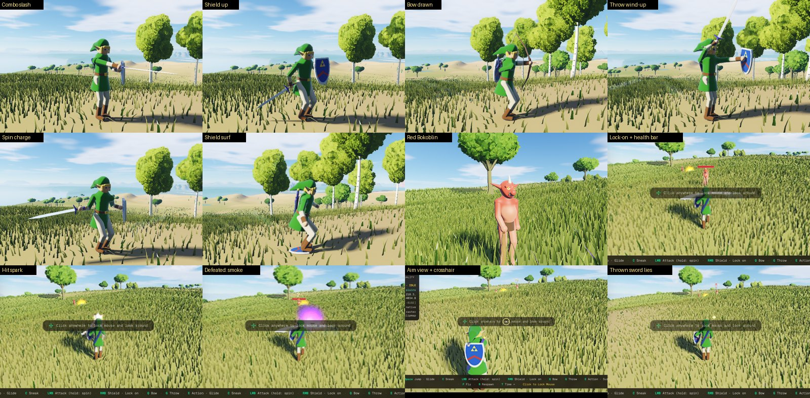

# Combat

The third-person hero fights after *Tears of the Kingdom*: a sword combo, a charged spin, jump and
dash attacks and sneakstrikes; a shield that guards, parries (a Perfect Guard) and locks onto a
foe; side hops and backflips that open a Flurry Rush when timed; a bow with bullet time in the
air; throwing the weapon in hand; shield surfing. Bokoblin camps wait round the land, the first a
few dozen metres up the rise ahead of the spawn. Hearts, weapons that wear out, arrows and hearts
dropped by beaten foes, a lock-on reticle, the foes' hearts, "!" and "?" over their heads. The shield and the bow
are carried like weapons, and food is kept to be eaten: [the inventory](INVENTORY.md). In
multiplayer, players fight each other with all of it too ([below](#other-players)).

Foes, arrows, sparks and smoke are drawn by the WebGPU renderer (Chrome / Edge), like other
players; on the WebGL2 fallback the hero still draws, swings and aims with its weapons, but no
camps wake. `?foes=0` in the URL is a peaceful world (the benchmarks play in one).

## Controls (third person)

Click the view first: the mouse is locked, and its buttons fight from then on.

| Input | Action |
| :--- | :--- |
| Left button (or J) | Attack: press again in time for the four-hit combo (slash, backhand, downcut, a lunging thrust) · in the air: jump attack · sprinting: dash attack · sneaking up on an unaware foe: sneakstrike (× 8) |
| Hold left button | Charge a spin attack (stamina); let go to spin |
| Right button (or K), held | Shield up: blows from ahead do no harm · raised just as a blow lands: **Perfect Guard** (the foe is dazed, an arrow flies back) · locks onto the foe (or player) nearest the view |
| Shield up, locked on: Space + A / D / S | Side hop / backflip · slipping a blow at the start of it: **Flurry Rush** (the world slows; click to rush in) |
| Shield up: E | Step onto the shield and surf (it speeds down slopes; Space jumps; E steps off) |
| Q, held | Draw the bow (over the shoulder, a crosshair with the arrows left in small type beside it, red at none) · left button: loose an arrow · in the air: bullet time (stamina) |
| G, held | Wind up a throw; let go to throw the weapon in hand (twice its damage; it lies where it lands) |
| E | Pick up a weapon lying near · with none: lift the rock ahead (a stone in one hand, a bigger one overhead in both) or push a boulder into a roll ([GROUND.md](GROUND.md#rocks)) |
| Carrying a rock: left button (or J) or G | Throw it along the view (drawn to a foe near the crosshair) · E puts it down |
| X | Next weapon carried |
| I | Inventory: equip weapons, shields and bows, eat ([`INVENTORY.md`](INVENTORY.md)) |
| M | Sounds off / on |
| + / − (numpad too) | The HUD one step more / less: everything ↔ the essentials ↔ nothing. The game starts on the essentials (the hearts, the minimap with its temperature and sound gauges, the clock, and what the fight is read by: the stamina wheel, the bow's crosshair, the foes' markers, banners, Game Over); the buttons, panels, settings, prompts, the gear in hand and the key banner come with +, and − twice from there hides everything |
| R | Respawn (after a Game Over the hero is back at the spawn by itself) |

Movement, sprint, sneak, jump, glide and climb are as before ([`HERO.md`](HERO.md)). The keys named here are the
defaults; each can be changed under Engine Settings → Controls (the mouse buttons stay).

## Numbers

| | |
| :--- | :--- |
| Hearts | 5 containers, in quarters; out of a fight for 9 s they come back (0.6 quarter/s); Bokoblins drop hearts; food restores them ([`INVENTORY.md`](INVENTORY.md)) |
| Pouch | 8 weapons, 6 shields, 5 bows, up to 999 of each food; the Master Sword, the Hylian Shield and the Traveler's Bow (never wearing out), 30 arrows and 3 Apples to start. No shield: no guard; no bow: no draw |
| Master Sword | 12 a blow, never wears out; thrown, it finds its way back after 9 s |
| Boko Clubs | dropped by Bokoblins: Boko Club 7 (14 blows), Spiked 11 (18), Dragonbone 17 (22), each swinging slower |
| Swings | combo ×1, ×1, ×1.1, thrust ×1.6 (knocks down) · spin ×2 all round · jump ×2 · dash ×1.3 · Flurry Rush 6 cuts |
| Bow | 30 arrows to start (99 at most), 15 at full draw, ×2 and a daze on the head; drop made up for to where the crosshair meets the ground or a foe |
| Perfect Guard | the shield raised within 0.24 s of the blow; Perfect dodge: within 0.26 s of a side hop or backflip |
| Bokoblins | red 26 HP, 1 heart a blow · blue 60, 1½ · black 120, 2 · an archer's arrow ½; one swings at a time, the others circling, each resting 1.3–2.8 s after its swing |
| Senses | seen 32 m in a ±69° cone (13 m when sneaking), heard 6 m all round (12 m sprinting); noticing takes 0.75 s (×2.5 sneaking) |
| Another player's blows | ⅓ quarter heart a point of damage, at least a quarter, at most 3 hearts: the Master Sword's slash 1 heart, its thrust 1½, a spin or a jump attack 2, a full-draw arrow 1¼ (a headshot 2½), the thrown sword 2 · no sneakstrikes · a Perfect Guard dazes the attacker 0.9 s |

All of them sit in `COMBAT` and `FOE` (`src/lib/constants.ts`), `WEAPONS` (`combat/weapons.ts`),
`FOE_KINDS` (`combat/foes.ts`) and `MOVES` (`combat/moves.ts`).

## Other players

In a multiplayer world (`server.mjs`, [`PROJECT.md`](../PROJECT.md) row 12) the players fight each
other as they fight foes: the sword and every swing, arrows (headshots too), thrown weapons; the
shield guards another player's blow, and raised just as it lands it is a Perfect Guard that dazes
the attacker (its blade turned, it reels a moment); a side hop or backflip just as the blow comes
slips it and opens a Flurry Rush on that player; the shield locks onto players as onto foes (their
hearts over their heads once hurt or locked onto). Felled by another player: *Game Over — Felled by*
its name, and the one who did it reads *Defeated* and the name. A fight with another player holds
back the hearts' return like a fight with foes. Foes stay each player's own.

- **Who decides.** Each player's own browser settles what strikes its own hero — what it sees is
  what hits it, so its shield, a Perfect Guard and a dodge answer a blow at the moment the blow
  lands on its screen. A blow goes out (as the swing reaches its window) stamped with the
  attacker's clock; the others hold it until their view of the attacker — played back 120 ms late
  from its snapshots — reaches that moment, then test it over the swing's window against their own
  hero, from where they see the attacker. A shot goes out as it is loosed, and flies in every
  other player's world from where it left the bow (a thrown weapon lies only in its thrower's).
  What came of it goes back to the attacker, timed the same way so it shows with the struck
  player's flinch: a hit or a fall, a block, a Perfect Guard (the attacker is dazed), a slip.
- **At once for the attacker.** Where the attacker sees the other player, its blade and arrows meet
  that player at once — the spark, the clank on a raised shield, the hit-stop, the weapon's wear —
  doing no harm there; the outcome only adds what was not seen (a parry, a fall, a headshot).
- **A Flurry Rush on a player.** A player cannot be slowed, so the world round the hero is not
  slowed either while the rush can start; its cuts go to that player alone, and neither its shield
  nor a dodge answers them (being out of reach does).
- **The wire.** Three messages of a few numbers each (`combat/pvp.ts`) through the relay, to every
  other player (a blow, a shot) or to one (a rush's cut, an outcome); snapshots carry the hero's
  hearts. In first person and in flight a hero is not fought (blows and shots on it are dropped).

## How it is built

- **The combat world** — `src/lib/combat/world.ts`. Owns the hero's fight (its locomotion runs in
  there: the acts build the `HeroInput` — a lunge, a heading to face, a speed factor, no climbing —
  and launch dodges and knockbacks), the foes, what flies and what lies on the ground, the camps'
  life cycle and the pace: a hit-stop on a blow that lands, the world slowed through a Flurry Rush
  or bullet time. Deterministic for a given input stream; pools made once, nothing allocated per
  tick. Events (a blow, a parry, a foe's alarm…) feed the sounds, effects and HUD.
- **The pouch** — shields, bows and food sit in the combat world beside the weapons (`shields` / `shieldOn`, `bows` /
  `bowOn`, `food`); [`INVENTORY.md`](INVENTORY.md) has its rules, tables and the screen that changes it.
- **Swings** — `combat/moves.ts`. Each swing is a few keys (blade yaw and pitch, hand reach and
  lift, torso twist) on a cubic Hermite through them, plus when it strikes, how far, how wide and
  what it does. The combat world times blows from them, the rig poses the arm along them.
- **Foes** — `combat/foes.ts`. Camps by hash on level dry ground (`campInCell`, the spawn's
  `spawnCamp`), waking within 120 m. A Bokoblin is a hero body and rig steered by its mind: idle and
  wander, notice, a jump of surprise, chase, wait its turn, wind up (the tell), swing; archers keep
  their distance; flinch, daze, knockdown, death and smoke.
- **Projectiles** — `combat/projectiles.ts`. Ballistic arrows and tumbling thrown weapons against
  the ground (bisected), tree trunks and water; `aimAt` finds the low arc to a mark.
- **The rig** — `hero/rig.ts` `poseCombat`. Over the locomotion poses: the weapon fetched from the
  back into the right hand and the shield onto the left arm, the blade riding its swing with the
  shoulders twisting along, the shield raised, the bow drawn with the string hand at the cheek, a
  throw's wind-up; a flinch or a daze over the upper body; a spin's yaw, a backflip, a side hop's
  roll, a knockdown. Out of it come the **gear frames** (`GEAR`: the weapon's grip, axis and flat,
  the shield's centre and face, the bow's grip, limbs and aim), packed with the joints.
- **Shaders** — the hero's signed-distance body (`gpu/hero.wgsl.ts`, `demoShader.ts` for WebGL2)
  draws the gear from those frames: the Master Sword (or a Boko club: wooden, spiked, bone), the
  Hylian Shield (its emblem in its own frame), the bow and its arrow — or whichever other shield and bow the
  pouch has in hand ([`INVENTORY.md`](INVENTORY.md)); a charged blade glows. The
  Bokoblin (`gpu/combat.wgsl.ts`) is its own distance body over the same rig — pot belly, big head,
  snout, ears, horn, tusks, loincloth — traced in its unit space (the ray taken to it by 1 / its
  scale), one scissored full-screen pass per foe with its block at a dynamic offset. Parts (lit
  boxes: arrows, weapons, a camp's logs and stones) and sprites (blended: sparks, smoke, the slash's
  trail, flames, rings, glints) are instanced draws over lists refilled every frame
  (`combat/scene.ts`, `gpu/combatGpu.ts`). Foes cast their shadows as two capsules each, with the
  other players'.
- **HUD** — `src/app/game/CombatHud.tsx`, from `combat/hud.ts`: published on change; the markers
  over the foes move every animation frame without React.
- **Sounds** — `combat/sfx.ts`: Web Audio, made on the fly (no files), placed by distance and side.
- **Multiplayer** — a snapshot also carries the hero's combat pose and hearts
  (`net/remoteHeroes.ts`), so players see each other swing, guard and draw; played back, each
  other player is a rival to the combat world (`combat/pvp.ts`, [above](#other-players)): the
  engine hands it the rivals and their messages before each step, and sends its own after. Foes
  are each player's own.

## Tests

`tests/combat.test.ts` (26 tests): the combo's chain; a swing's reach and arc; sneakstrike ×8;
the spin's charge, stamina and sweep; jump and dash attacks; Perfect Guard, guarding, a blow from
behind; lock-on, a timed side hop, the Flurry Rush's slowed world and its cuts; surfing down a
slope, to a stop up a rise, stepping off; `aimAt`'s arc; an arrow's headshot and one stuck in the
ground; bullet time; a throw, its damage, the sword's return; a club's wear and break; the foes'
senses (cone, behind, sneaking); their turns and rests; hearts, falling and revival; a beaten foe's
smoke and drops; archers and the shield against them; the lobby's pause; determinism; the camps'
placement and wake / sleep; bone lengths and orthonormal gear frames in every combat pose, the
blade's tip inside the bound; the swings' keys; the scene's packing. `tests/multiplayer.test.ts`
covers the pose and the hearts in snapshots (and older snapshots without them), `tests/hero.test.ts`
the uniform layout with the gear.

`tests/inventory.test.ts` covers the pouch: equipping, the shield's and the bow's wear, food and loot.

`tests/pvp.test.ts` (18 tests) joins two players' combat worlds as the game does — each one's
snapshots played back by the other's `RemoteHeroes`, the messages through a relay 40 ms away, the
two clocks apart — on the real terrain: a slash costs a heart, no sooner than the struck player's
view shows it; out of reach or behind the swing it misses; a spin sweeps a player behind; a fight
holds the hearts back, guarded blows too; a fall names its player; a guard, a Perfect Guard and the
attacker's daze; a perfect side hop and a Flurry Rush through a raised shield, the world not slowed;
the lock onto a player; an arrow flying in the other world, a headshot, an arrow parried back into
its archer, a thrown sword (in the thrower's world only); nothing sent alone; malformed and early
messages, a player who leaves.

Played through the relay too: two headless Chromes (WebGPU) joined from the lobby on `server.mjs`
— an arrow (5 → 3¾ hearts), a slash (→ 2¾, the bar over the struck player at 55 % on the
attacker's screen), a guarded slash and a Perfect Guard (no harm), a Perfect Dodge and a Flurry
Rush through the attacker's shield (5 → 3), slashes until *Game Over — Felled by Alpha* /
*Defeated Beta*, and back at the spawn with every heart.

## Measured cost

Apple M1, headless Chrome (WebGPU, Metal), Medium preset, 1280×720, the dev build, the play
session's scripted run up to the spawn's camp, uncapped frames (interleaved, both orders):

| | foes off | foes on (two Bokoblins fighting) |
| :--- | :--- | :--- |
| Frames per second | 212.8 | 206.4 (−3 %) |
| CPU per tick, p50 / p95 | 0.5 / 0.65 ms | 0.6 / 0.85 ms |
