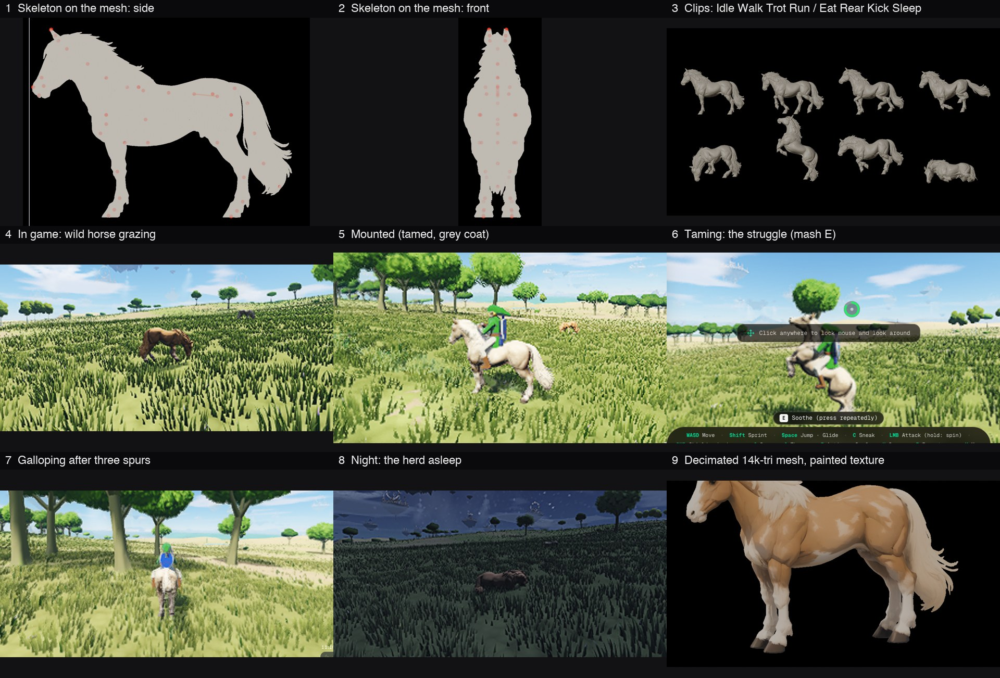

# Horses

Wild horses live in herds on the open grassland and can be tamed and ridden, after *Breath of the Wild* and *Tears of the Kingdom*.

## Playing

| Key | On foot | On horseback |
|---|---|---|
| **E** (Action) | Mount the horse in reach | Soothe (while taming) · Dismount |
| **W A S D** | | Steer the camera's way; a sharp turn back brakes, then backs up |
| **Shift** (Sprint) | | Spur: one gait up (walk → trot → canter → gallop); the pips come back with rest |
| **Space** | | Leap (from a trot or faster) |
| **C** (Sneak) | Creep up on a wild horse without it bolting | |
| **Z** (Whistle) | Call your horse | |

- **Herds** of 3–7 horses live in the plains and the savanna (a few on the highland and lake shores). They are the same herds, coats and horses on every visit to a seed. They graze, idle and wander round their herd's spot. Grazing goes in phases: eating with the head down, cropping side to side; now and then the head comes up, straight, looking round; or a few slow steps to fresh grass. Standing about, a horse looks round too. The head's turn is added to the clips by the game (`model.ts turnJoints`, the neck from `spine_5` up).
- **Senses:** a horse notices you within about 17 m (6 m sneaking, 24 m sprinting) and looks up at you. If you come within about 10 m without sneaking, it bolts and its herd bolts with it. Sneaking, you can walk right up to one.
- **Taming:** mounting a wild horse starts a struggle. It rears and bucks while your stamina drains; press **E** repeatedly to soothe it. A wilder horse (its temper) takes longer. Run out of stamina and you are thrown off and it gallops away. Tamed, it is yours: it stays where you leave it and comes to your whistle.
- **Each horse is unique:** its coat is made by the shader from its own seed (`horses.wgsl.ts hsCoat`), with the painted texture kept only for brushwork:
  - **Colour:** bay, chestnut, black, grey, palomino, buckskin, dun or cream, in its own shade. Nearly half of a herd shares a colour.
  - **Pattern:** solid, pinto blotches, or an appaloosa's spotted rump blanket. Greys are dappled; duns have a stripe down the back.
  - **Points and markings:** dark lower legs on bays and buckskins, white socks to its own height on any leg, and a star or a blaze on the face.
  - **Mane and tail** in their own colour (tagged in the mesh by the build).
  - Each horse also has its own gallop speed and spur count (2–5).
- **Health:** a horse has 64 health. The hero's sword, arrows, thrown weapons and rocks hurt it (the combat world's `beasts`). A hurt horse bolts with its herd and shows a life bar over it. At 0 it dies: the death clip plays, then it vanishes, dissolving along a faintly glowing edge in a drift of pale motes. A slain horse never comes back.
- **Riding:** the horse refuses a drop of more than about 3 m, a slope too steep to climb and deep water. Ridden, it stops when it runs into a tree or a boulder. Being struck knocks you off.
- **In the way:** a horse walking or running on its own that meets a trunk, a boulder, a drop, a slope too steep or deep water turns away from it, the side away from a trunk, and goes that way a moment. A wandering horse picks a new spot that way.
- **At night** (21:00–05:00) the herds lie down and sleep. Coming close without sneaking wakes them, and they bolt.
- **Bodies:** on foot you can't walk through a horse; you slide along its body. A horse faster than a slow trot running into you throws you, as does being thrown off during taming or struck on horseback. The hero then goes limp: a ragdoll flies, tumbles, lands and comes to rest, and the hero gets up from lying on the back. `src/lib/hero/ragdoll.ts` holds the ragdoll: the rig's joints as Verlet particles with bone-length constraints on the ground plane under the pelvis. It is handed back to the rig's knockdown pose to rise (the combat world's `thrown` and `rising` acts).

## How it is built

- **The model** is `public/models/horse.bin` (+ `horse.jpg`), built by `scripts/horse/build.py` (headless Blender) from `~/Desktop/3D Characters/Animals/Horse`:
  - **Mesh:** `Horse.glb`'s painted horse, decimated from 1.5 M to 14 k triangles and scaled to 1.55 m at the withers.
  - **Skeleton and clips:** `Horse Rigs.glb`'s 56-joint skeleton and its 13 clips.
  - **Fitting:** the rig's proportions are not the mesh's (longer legs, higher neck), so every joint is placed on the mesh by hand (`JOINTS`, read off a measured side view). The rig gives the hierarchy and the clips' rotations.
  - **Bind pose:** Idle's first frame (Rest_Pose holds the tail out straight).
  - **Weights:** Blender's bone heat weights the mesh.
  - **Baking:** every clip is baked at 30 fps into a 3×4 skinning matrix per joint per frame, in the game's frame (+Y up, facing +Z).
  - **Preview:** `--preview out.png` renders the bound mesh posed from the baked frames, which is exactly what the game draws.
- **The game side:**
  - `src/lib/horse/herds.ts`: where herds live.
  - `src/lib/horse/horses.ts`: each horse's mind (graze, idle, wander, alert, flee, lie, sleep, rise, come, struggle, ridden), riding, and packing for the renderer.
  - `src/lib/horse/model.ts`: the loader and clip blending.
  - `src/lib/gpu/horses.ts` / `horses.wgsl.ts`: one instanced, skinned, textured draw, plus a draw into the trees' sun shadow map.
  - `rig.ts poseRide`: the seated rider.
  - `HeroState.riding`: hands the hero to the horse.
- **Cost:** a horse samples the ground (about 10 µs) only after moving 0.4 m, and looks ahead five times a second, so a grazing herd costs nothing. The GPU draws up to 16 horses at 14 k triangles each.

## Not done (yet)

- No horses in multiplayer: other players see your hero running, not riding.
- No horses with the WebGL2 renderer.
- No stables, saddles or names.
- No following roads by itself, and no swimming.
- No mounted combat.
- The ragdoll ignores trees and rocks, and other players don't see it.
- Foes don't attack horses, horses don't heal, and you can't strike your own mount from the saddle.
