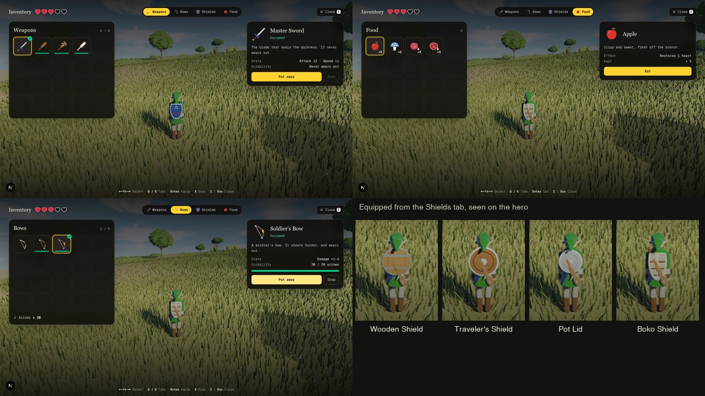

# Inventory

The hero's pouch, after *Breath of the Wild*'s pause menu: weapons, bows, shields and food are carried,
and a screen lists each in a grid to equip, put away, drop or eat. The shield and the bow are things
the hero carries now, not fixtures: a Wooden Shield, a Pot Lid or a Soldier's Bow can be found, worn out
and broken, and the hero draws each as it carries it.

Press **I** (or the backpack button in the top-right bar) in third person. The mouse is freed, the keys
leave the hero alone, and behind the screen the hero shows what it wears. **I** or **Esc** closes it.

## The screen

| Input | Action |
| :--- | :--- |
| I (rebindable, Engine Settings → Controls) · the backpack button | Open / close the inventory |
| Arrows / WASD, or the mouse | Select an item |
| Q / E (or Tab / Shift+Tab), or a tab | Weapons · Bows · Shields · Food |
| Enter / Space / F, double click, or the button | Equip (or put away what is in hand) · eat |
| X / Delete, or the Drop button | Drop the item in front of the hero |
| I / Esc / the Close button | Close |

Each tab is a grid of 20 places (5 × 4) with a ✓ on what is in hand and a wear bar under what wears out
(it blinks red when little is left); the panel on the right names the selected item, tells its stats, how
much durability it has left and what it is for. The Bows tab also shows the arrows in the quiver; the hearts
sit at the top. Food can be eaten only when the hearts are not full (the button goes dim, and says so).

**What stands still.** Alone in the world, everything does — the foes, what flies, the sky clock, the shaders'
clock (the wind in the grass), the hero itself — except the pose, which follows what is carried. In a shared world the world goes on, as behind the
lobby: the foes (each player's own) and arrows in flight stand still, the hero keeps its place and can be
hit by another player, the clock keeps running. Opening the screen lets go of a raised shield, a drawn bow
and a charging spin.

## What is carried

| | In the pouch | Start | Notes |
| :--- | :--- | :--- | :--- |
| Weapons | 8 | Master Sword | the sword among them; swapping, throwing and wear as before ([`COMBAT.md`](COMBAT.md)) |
| Shields | 6 | Hylian Shield | with none in hand the right button does nothing (a dud, "No shield") — no guard, no lock-on, no surfing |
| Bows | 5 | Traveler's Bow | with none in hand Q does nothing ("No bow") |
| Food | 999 of each kind | 3 Apples | kept as counts |

The hero's own gear — the Master Sword, the Hylian Shield, the Traveler's Bow — never wears out and cannot be
dropped (it can be put away). When what is in hand breaks, that goes back into the hands (the sword, the Hylian
Shield, the Traveler's Bow), else the first one carried, else nothing.

| Shield | Lasts (blows guarded) | Hold | |
| :--- | :--- | :--- | :--- |
| Hylian Shield | never wears out | firm (push × 0.7) | the hero's own |
| Wooden Shield | 16 | steady (× 1) | planks and iron straps |
| Traveler's Shield | 24 | firm (× 0.85) | leather in a steel rim, a boss |
| Pot Lid | 10 | shaky (× 1.4) | dull steel, a knob |
| Boko Shield | 14 | shaky (× 1.15) | hide on a bone frame |

*Hold* is how far a guarded blow pushes the hero back (× 3.2 m/s). A shield wears one a blow it guards (not a
Perfect Guard: that costs nothing) and one every 4 s the hero surfs on it; it breaks at none.

| Bow | Arrow damage | Lasts (arrows loosed) | |
| :--- | :--- | :--- | :--- |
| Traveler's Bow | × 1 | never wears out | the hero's own |
| Boko Bow | × 0.7 | 18 | pale wood, bone tips |
| Soldier's Bow | × 1.4 | 30 | dark lacquer, a gold grip, steel tips (in a fight with another player too: the damage rides the shot) |

| Food | Restores |
| :--- | :--- |
| Apple | ½ heart |
| Hylian Shroom | ½ heart |
| Raw Meat | 1 heart |
| Raw Prime Meat | 2 hearts |

All of them sit in `SHIELDS`, `BOWS` and `FOODS` (`combat/weapons.ts`), the slots and the start in `COMBAT`
(`src/lib/constants.ts`: `weaponSlots`, `shieldSlots`, `bowSlots`, `maxFood`, `startApples`, `surfWear`).

## Where things come from

- **Pick up** a shield or a bow lying near with the action key (E): it joins the pouch, and goes into hand only
  if none was. With every slot of its kind full it is left lying ("No room for…"). Weapons keep their rule: the
  one in hand makes way. Gear lies 4 minutes, food 90 s.
- **Food** is taken just by walking over it (within 1.3 m), unless 999 of the kind are kept.
- **Bokoblins** drop, besides their club, arrows and hearts as before: a meal one time in three (red: an Apple or a
  Hylian Shroom, blue: a Shroom or Raw Meat, black: Raw Meat or Raw Prime Meat); a shield one time in five (red:
  a Boko Shield, blue: a Wooden Shield, black: a Traveler's Shield); an archer a bow one time in two (a Boko Bow;
  a black archer's, a Soldier's).
- **A cleared camp** leaves its spoils by the fire, picked by the camp's hash: a Wooden Shield, a Traveler's Shield,
  a Pot Lid, a Boko Shield, a Boko Bow or a Soldier's Bow.
- `?kit=1` in the URL starts with one of everything in the pouch, and the hero at three hearts, to try the screen
  (`CombatWorld.stock()`).

## How it is built

- **Tables** — `combat/weapons.ts`: `SHIELDS`, `BOWS`, `FOODS` with their index constants (`SHIELD`, `BOW`,
  `FOOD`), the model ids the shaders draw (`SHIELD_MODEL`, `BOW_MODEL`) and `ITEM_CODE` / `itemName`, which name an
  item in an event (`pickup`, `break`, `equip`, `eat`: a weapon's index, or a category's base + the index).
  Foes' loot is in `FOE_KINDS` (`combat/foes.ts`: `food`, `shield`, `bow`).
- **The world** — `combat/world.ts`: `shields` / `shieldOn`, `bows` / `bowOn`, `food`; the calls the screen
  makes, applied at once: `equip`, `unequip`, `discard`, `eat`, `cancelActs`, `refreshPose`; `wearShield` and
  `wearBow`; the loot (`vanish`, `spoils`) and pickups (`nearestPickup`, `canTake`). Deterministic and
  allocation-free per tick like the rest.
- **The channel** — `combat/pouch.ts`: `readPouch` reads the lists out of the world for the screen, a store
  publishes it on change, and `PouchCommand` is what the screen sends back through the engine's handle.
- **The pause** — `engine/engineCore.ts`: the page passes `menuOpen`; the keys and buttons are dropped, the
  pointer freed, and alone in the world the frame loop skips the step, the clock and the effects (re-posing the
  rig so new gear shows). `onKey` catches the inventory key above the lobby's block, so the same key closes the
  screen. The page asks the engine nothing else: every action is a handle call.
- **The screen** — `app/game/InventoryScreen.tsx` (loaded when first opened), icons in `ItemIcon.tsx` (shared
  with the combat HUD, which shows the weapon, shield and bow in hand with their wear, and the food kept).
- **On the hero** — the rig's gear frames carry the models: `GEAR.shield.w` and `GEAR.bow.w` hold the model id
  (0: none) instead of a flag, so the uniform layout is unchanged. The hero shaders (`gpu/hero.wgsl.ts`,
  `demoShader.ts` for WebGL2) pick the outline by model in the distance code (heater, longer kite, three discs) and
  keep the rest — planks, straps, rim, boss, lashings, the bows' wood, bone, gold and steel — in the albedo,
  which runs once a pixel. Lying shields, bows and food are lit boxes (`combat/scene.ts`).
- **Multiplayer** — a snapshot carries the two models (`net/remoteHeroes.ts`: `shield` 27, `bow` 28), so the
  other players see each other's gear; older snapshots show the Hylian Shield and the Traveler's Bow. The
  weapon's damage and the bow's already ride a blow and a shot.

## Tests

`tests/inventory.test.ts` (32 tests): the tables (the start, unique models, index names, whole-quarter food, what
wears); eating (the hearts back, capped, refused at full hearts, with none, or down); equipping and putting away
each category, picking up a shield and a bow, a full slot, dropping and picking up again, the hero's own kept, the
list indices kept straight; no guard without a shield and no bow without one (a blow lands), a bow put away
mid-draw; wear (a shield per guarded blow and its break, a Perfect Guard free, a firmer shield steadier, surfing,
a bow per arrow, its damage and its break); food collected and a full stack left; what lies stays a while; foes'
drops and a cleared camp's spoils; the pause (hands let go, a pose without a step); the kit; determinism.
`tests/multiplayer.test.ts` covers the two models in snapshots (and older ones); `tests/keybinds.test.ts` the new
action.

Driven in headless Chrome (WebGPU, and WebGL2 in software) on `/game?solo=1&foes=0&kit=1`: I opens the screen;
the tabs by mouse and by Q / E; a club, each shield and a bow equipped; an Apple eaten (3 → 3½ hearts, one fewer
kept) and eating on by Enter to full hearts, where the button dims; the sky clock stopped behind the screen and
running again after, and the grass standing still (frames 6× steadier than in play: only the anti-aliasing's
jitter is left); I and Esc closing it; the HUD's rows; no shader errors. The WebGL2 view's shaders compile and link
with the new gear and draw each shield's outline (headless Chrome loses its WebGL2 context now and then, so its
frames were taken early in short sessions). Two players through the relay (`server.mjs`, two headless Chromes
joined from the lobby): one equips each shield and a bow, the other sees the Wooden Shield's planks, the Pot Lid,
the Boko Shield's lashings, and the Traveler's and the Soldier's Bow drawn, along with the guard. Rebinding the key
in Engine Settings → Controls (to B): saved, the old key does nothing, the new one opens and closes the screen, and
the Close button names it.

## Measured cost

Apple M1, headless Chrome (WebGPU, Metal), Medium preset, 1280×720, the dev build, an idle hero at the spawn,
uncapped frames (frames submitted per second after 6 s of warm-up, 8 s measured), the hero shader's new gear code
(the shield and bow models) against the old code folded away at compile time, in one build, alternated
new-old-old-new-new-old-old-new with 12 s between sessions:

| | frames per second |
| :--- | :--- |
| Old gear code | 211.5, 203.8, 225.8, 226.6 (mean 216.9) |
| New gear code | 221.1, 226.3, 219.6, 197.3 (mean 216.0) |
| New / old | 0.996 |

Run to run the sessions vary ±10 % (the machine was not quite idle); the ratio is within that. The screen itself
costs nothing while it is closed (it is not mounted), and the pose, gear and loot code is a few comparisons a tick.
