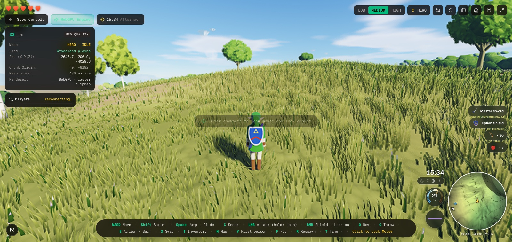
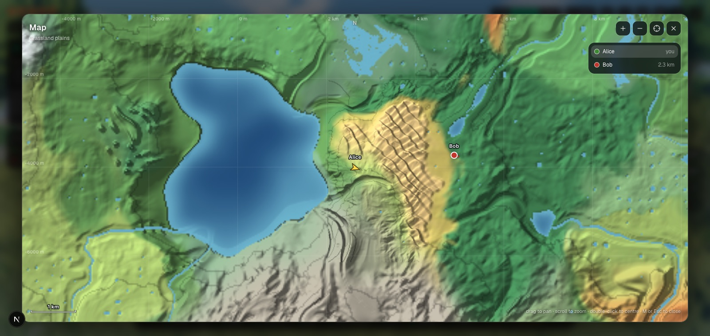

# Map and HUD

The corner of the screen after *Tears of the Kingdom*: a round **minimap** that turns with the view, the
**temperature gauge** and the **sound meter** beside it, the time of day over them — and a full **map** on
**M**. Other players show on both, so friends in a shared world can find each other. The hearts and the
stamina wheel were redrawn to match: flat, coral-red hearts with no outline, a bright green wheel.

| Input | Action |
| :--- | :--- |
| M (rebindable, Engine Settings → Controls) · the map button · a click on the minimap | Open / close the map (the sound's key moved to **N**) |
| Drag · scroll | Pan · zoom the map |
| Double click · C · the crosshair button | Back to the hero (the map follows it again) |
| + / − (map open) | Zoom |
| Esc · M | Close |
| + / − | (with the map closed) the HUD one step more / less: the game starts on the essentials — the hearts, this corner — **+** brings the rest (buttons, panels, key banner, the gear in hand), **−** twice from there hides everything |

In the cloud world (inactive: reached only by the Engine Settings' World switch) there is no map yet: the minimap and the map say
*No map of the cloud world* in place of the land's tiles, and still show the other players in that world.

## The minimap

Round, with the rim 360 m from the hero; the whole corner is sized by the screen's width (12.5 % of it for the
minimap, 128–224 px), as a console's HUD is. The hero's arrow is always up, a pale cone shows what the camera sees,
a small **N** on the rim shows where north lies, and the hero's x, z and height run along the lower rim. A player in reach is a dot in their hero's colour with a nub for the way they
face; a player beyond the rim is a pointer on it, towards them. The picture is drawn every frame it changes
(nothing moved, nothing drawn) by its own animation frame, from the engine's channel (`mapHud`), not by React.
The clock under the gauges shows the game's time of day in steps of five minutes (`clockText5`; the four icons
are night, dawn, day, dusk). The hearts are small, squat and one flat light coral-red, as in the reference.

## The gauges

* **Temperature** — `gauges.ts ambientTemp`: the world's climate (`terrainMath.ts temperature`: the sea-level
  field less the lapse with height) with the day's swing on top, warmest at 15:00, coldest at 03:00, wider where
  the air is dry. Climb a mountain or a sky island and it falls. The arc runs −15…45 °C, blue to orange.
* **Sound** — `heroNoise`: nothing standing or in the air, a murmur sneaking, a steady beat running, a roar
  sprinting or surfing; a spike on a hard landing and on a blow, a block, a Perfect Guard or a weapon breaking.
  Quick to rise, slow to fall. The trace is violet when quiet and turns hot pink when loud.

## The map

North is up (z is north, x east: the camera's right when it faces +z). The ground is drawn from the world's
own maths — `terrainMath.surfaceAt` and the biome regions' weights — in `tiles.ts renderTile`: biome colours
that lighten to bare rock with height and turn to snow where the air is below freezing, relief shading from
the north-west, contour lines (every fifth is an index line; the interval grows as the map zooms out), water
that darkens with depth, ice and lava. A grid in round distances, a scale bar and the cursor's coordinates
help read it. In the list at the right, click a player to follow them.

Painting a 128 × 128 tile costs ~0.2 s, so it is done off the main thread: `tileService.ts` asks two workers
(`tilesWorker.ts`) for the tiles a frame wants — the nearest first, a coarse tile ahead of its fine ones, a
request not renewed for a few frames dropped — keeps 260 of them in an LRU cache, and shows the coarsest
painted tile over one still being painted. Without Workers it paints one tile at a time between frames.
Level *L* has 2·2^*L* m to the pixel (levels 0–7, 2 m … 256 m).

Like the inventory, the map is a menu: the hero is left alone, the mouse is freed, and alone in the world
everything stands still behind it; in a shared world the world goes on and the dots move.

## Where it lives

* `src/lib/map/mapHud.ts` — the channel (a mutable object the engine writes every frame): the hero, the view's
  heading, the other players, the temperature, the noise.
* `src/lib/map/gauges.ts` — the temperature and noise maths.
* `src/lib/map/tiles.ts`, `tilesWorker.ts`, `tileService.ts` — the ground and how it reaches the screen.
* `src/app/game/MapHud.tsx` (the corner), `MapScreen.tsx` (the map), `mapDraw.ts` (drawing both share),
  `CombatHud.tsx` (the hearts), `page.tsx` (the stamina wheel, the layout).
* The engine (`engineCore.ts feedMap`) fills the channel; `publishStats` refreshes the temperature five times a second.

Tests: `tests/map.test.ts`, and `tests/keybinds.test.ts` (the sound key's move from M to N: bindings saved with
the sound still on M follow the new default; one the player moved is left alone).
